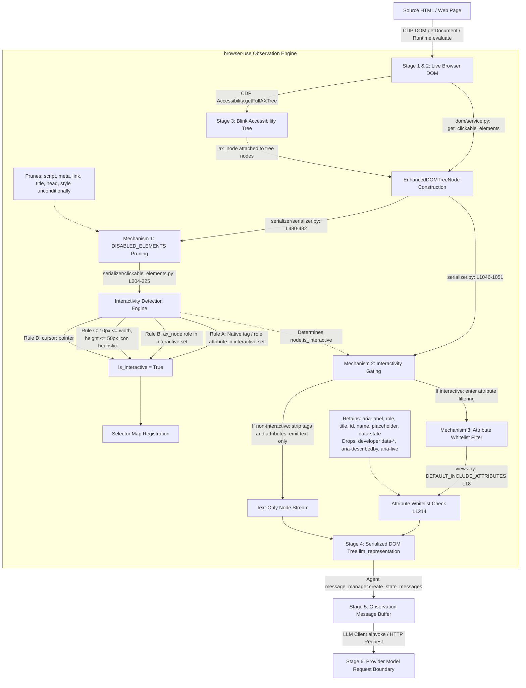

# BROWSER-USE 0.13.10 OBSERVATION PIPELINE DATA FLOW AND CIRCULARITY
**Generated (UTC):** 2026-10-26T19:34:48.313118+00:00  
**Package:** `browser-use==0.13.10` (SHA-256 verified)

---

## 1. Architectural Data Flow Diagram



---

## 2. Mathematical Formalization of the Serialization Gap

Let $\mathcal{C}$ represent the set of semantic metadata channels present in the document. For a given channel $c \in \mathcal{C}$, we define retention indicator functions across pipeline stages $s \in \{1, 2, 3, 4, 5\}$:
$$\mathbf{1}_s(c) \in \{0, 1\}$$

The **DOM Serialization Gap** $\mathcal{G}(c)$ is the information loss between the Live DOM ($s=2$) and the Agent Observation Buffer ($s=5$):
$$\mathcal{G}(c) = \mathbf{1}_2(c) - \mathbf{1}_5(c)$$

### Pruning Mechanism Classification:
1. **Mechanism 1 (Element-Level Pruning):**
   $$	ext{Tag}(e) \in 	exttt{DISABLED\_ELEMENTS} \implies e 
otin 	ext{Stage 4}$$
   Applies to: `<script>` (JSON-LD), `<meta>`, `<title>`, `<head>`, `<link>`.
   $\mathcal{G}(	ext{JSON-LD}) = 1 - 0 = 1$ (100% loss).

2. **Mechanism 2 (Interactivity-Gated Structural Dropping):**
   $$
eg 	ext{Interactive}(e) \land 
eg 	ext{Scrollable}(e) \implies 	ext{Attrs}(e) = \emptyset$$
   Applies to: `aria-label` on non-interactive `<span>`/`<div>`, `role="region"`, developer `data-*` on containers.
   $\mathcal{G}(	ext{Container ARIA}) = 1 - 0 = 1$ (100% loss).

3. **Mechanism 3 (Attribute Whitelist Filtering):**
   $$a 
otin 	exttt{DEFAULT\_INCLUDE\_ATTRIBUTES} \implies a 	ext{ omitted}$$
   Applies to: `data-action`, `data-product-id`, `aria-describedby`, `aria-labelledby`, `aria-live`.
   $\mathcal{G}(	ext{Developer } data	ext{-*}) = 1 - 0 = 1$ (100% loss).

---

## 3. Selector Map vs. Blink AXTree Circularity (C4 Audit Finding)

A central finding of this audit is that **the selector map's correspondence with the Blink AXTree is partially circular by construction**.
In `serializer/clickable_elements.py` (L204–225):
```python
if node.ax_node and node.ax_node.role in INTERACTIVE_ROLES:
    node.is_interactive = True
```
