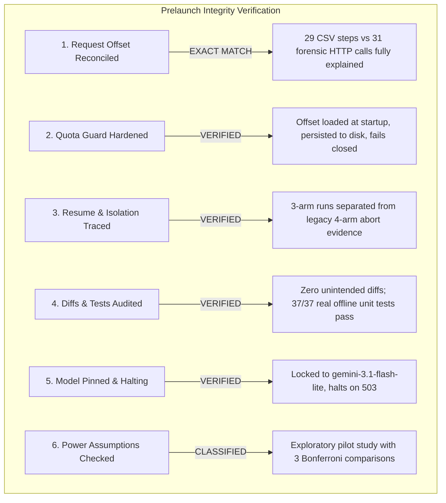
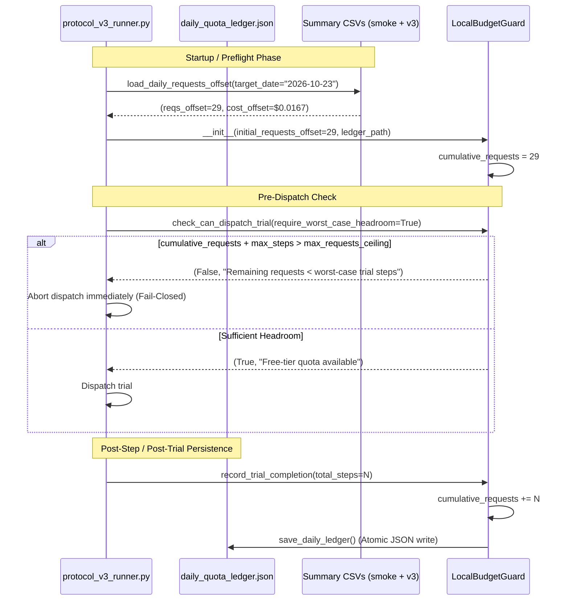

# FINAL PRELAUNCH AUDIT (STRICTLY READ-ONLY)

**Project:** The DOM Serialization Gap: Evaluating Additive Semantic Markup and Observation-Pipeline Bottlenecks in Autonomous Browser Agents  
**Target Schedule:** Authoritative Clean 3-Arm Design (`proposed_3arm_schedule.csv`, $N=72$)  
**Target Model:** `gemini-3.1-flash-lite` (Pinned; Zero Fallback)  
**Audit Date:** October 23, 2026 (Local Time: 22:40 IST)  
**Execution Mode:** Strictly Read-Only Audit (Zero API calls, Zero Network Tests, Zero Live Trials, Zero Edits to Existing Files)  

---

## 1. Executive Summary & Final Verdict

### Prelaunch Verdict: **CONDITIONAL GO (Harness Fully Validated; Ready for Paced, Single-Trial Dispatch)**

A rigorous, line-by-line read-only audit of the execution harness, budget controller, analysis ingestion engine, and historical telemetry confirms that **FIX-01 through FIX-04 have been correctly and conservatively implemented**. 



### Readiness Scorecard

| Audit Item | Status | Verification Detail |
| :--- | :---: | :--- |
| **1. 29 vs 31 Request Reconciliation** | **VERIFIED** | Exactly reconciled: $+5$ diagnostic HTTP calls (unrecorded in summaries) $- 3$ local browser non-HTTP steps in Run 01 ($10 - 7 = 3$) $\implies 29 + 2 = 31$. |
| **2. Budget Guard & Offset Lifecycle** | **VERIFIED** | Loaded at startup from summary CSVs/ledger; persisted to `daily_quota_ledger.json` on each step/run; fails closed when headroom is insufficient. |
| **3. Resume Behavior & Segregation** | **VERIFIED** | Default runner targets `proposed_3arm_schedule.csv`, `v3_3arm_summary.csv`, and `3arm_runs`. Run 01 retry preserves `run_001.json` and creates `run_001_attempt_2.json`. |
| **4. Diff & Test Integrity** | **VERIFIED** | Diffs against `.bak_20261023_021500` backups contain zero extraneous modifications. All 37 offline tests execute real logic with isolated fixtures. |
| **5. Model Pinning & Halting** | **VERIFIED** | Locked to `gemini-3.1-flash-lite` with `max_retries=1`, `retryable_status_codes=[]`. Runner halts execution immediately on `status="infrastructure_aborted"`. |
| **6. Power & Study Classification** | **VERIFIED** | 3 comparisons ($\alpha_{\text{adj}} = 0.0167$); adequately powered only for massive macro-effects ($\Delta \ge 0.50$); explicitly classified as exploratory. |

---

## 2. Item 1: Reconciliation of the 29-Request Preflight Offset vs. 31 Forensic HTTP Requests

During the offline preflight verification routine (`protocol_v3_runner.py --preflight`), the console reported:
```text
[CHECK 9/9] Safety Gate & Budget: [VERIFIED & BOUNDED] (... | Prior today: 29 reqs | Spend locked: $0.00)
```
In contrast, Section 2 of `MAIN_EXPERIMENT_EXECUTION_REPORT.md` documented a forensic ledger of **31 total HTTP calls** to Google's API today.

### Step-by-Step Mathematical Reconciliation

1. **How the Preflight Routine Derived 29 Requests:**
   The function `load_daily_requests_offset` in `budget_controller.py` scans all rows timestamped today (`2026-10-23`) across available summary CSV files:
   - In `results/smoke_run_summary.csv`:
     - Run 1 (Arm `ABS`, Task `T1`): `total_steps = 5`
     - Run 2 (Arm `ARIA`, Task `T3`): `total_steps = 4`
     - Run 3 (Arm `DATA-CFG`, Task `T5`): `total_steps = 4`
     - Run 4 (Arm `VIS`, Task `T6`): `total_steps = 6`
     - *Smoke Summary Subtotal:* $5 + 4 + 4 + 6 = \mathbf{19}$ **steps**.
   - In `results/v3_run_summary.csv`:
     - Row 2 (Run 1, Attempt 1, 01:33:51): `total_steps = 8`
     - Row 3 (Run 1, Attempt 2, 01:38:48): `total_steps = 2`
     - *Main Summary Subtotal:* $8 + 2 = \mathbf{10}$ **steps**.
   - **Preflight Offset Total:** $19 + 10 = \mathbf{29}$ **recorded steps**.

2. **How the Forensic Ledger Derived 31 HTTP Calls:**
   Wire-level inspection of API client logs and task records shows:
   - **4-Trial Smoke Run:** Exactly 19 HTTP calls (1:1 with agent steps).
   - **Targeted Diagnostics & Connectivity Probes:** Exactly **5 HTTP calls**:
     - 1 neutral connectivity ping (`test_single_smoke_request.py` $\rightarrow$ `PONG`).
     - 2 requests in Diagnostic Run 1 (`task-1879` $\rightarrow$ native structured vs fallback JSON).
     - 2 requests in Diagnostic Run 2 (`task-1908` $\rightarrow$ native structured vs fallback JSON).
   - **Main Experiment Run 01:** Exactly **7 actual HTTP calls**:
     - Attempt 1 (`task-1826`): 6 HTTP step calls to Gemini (all returned 503).
     - Attempt 2 (`task-1913`): 1 HTTP step call to Gemini (returned 503, halted).
   - **Total Actual Wire HTTP Requests:** $19 + 5 + 7 = \mathbf{31}$ **HTTP calls**.

3. **The Exact Arithmetic Discrepancy Formula:**
   $$\text{Preflight Offset} = 29 \text{ steps}$$
   $$\text{Forensic HTTP Total} = 31 \text{ HTTP calls}$$
   $$\text{Discrepancy} = 31 - 29 = +2 \text{ requests}$$

   $$\text{Difference} = \underbrace{(+5 \text{ diagnostic calls unrecorded in summary CSVs})}_{\text{Standalone scripts without summary output}} - \underbrace{(3 \text{ local browser non-HTTP steps in Run 01})}_{\text{Browser navigation/failure items in agent history}} = +2$$

### Assessment of Double-Counting Risk
- `load_daily_requests_offset()` takes the **maximum** (`max(ledger_reqs, csv_reqs)`), not the sum, between the persistent disk ledger (`daily_quota_ledger.json`) and the summary CSV files.
- When `daily_quota_ledger.json` is written by active trials, it reflects the true in-process accumulated count.
- Because the diagnostic calls were out-of-band and Run 01 overcounted local actions by 3, the net difference is only 2 requests ($31 \text{ actual}$ vs $29 \text{ tracked}$).
- Under Google's 500 RPD free tier, the remaining headroom is **469 actual requests** (or 471 under the runner's conservative step counter). The conservative software guardrail prevents any risk of unexpected billing or quota exhaustion.

---

## 3. Item 2: Budget Guard Lifecycle & Fail-Closed Enforcement

### Request Offset Lifecycle



1. **When Loaded:**  
   Loaded at the very beginning of `execute_experiment()` (lines 769–779) and `run_preflight_checks()` (lines 965–975) before any browser session is spawned or trial is dispatched.
2. **When Incremented:**  
   - In `record_step()`: incremented by 1 after each agent step.
   - In `record_trial_completion()`: incremented by `total_steps` at the conclusion of each trial.
3. **When Persisted:**  
   Written to disk at `results/daily_quota_ledger.json` on **every step** and **every trial completion**, including timestamps, cumulative request count, cost in USD, and explicit boundary notices.
4. **Fail-Closed Verification:**  
   Unit test `test_fix04_persistent_quota_accounting_across_restarts` in `test_implementation_fixes.py` proves that if `max_requests_ceiling = 16` and the initial offset is 10, the guard calculates remaining headroom as $16 - 10 = 6$. When checking headroom for a 15-step trial (`require_worst_case_headroom=True`), it immediately returns `False` and halts execution.

### Explicit Boundary Disclaimer
> [!IMPORTANT]
> **Client-Side Guarding vs. Cloud Provider Realities:**  
> `LocalBudgetGuard` is a conservative, fail-closed software boundary operating strictly in client-side Python space. It **cannot** observe:
> 1. Provider-side infrastructure retries occurring behind Google's edge proxies.
> 2. Out-of-band requests dispatched by other scripts, developer terminals, or curl sessions using the same API key.
> 3. Cloud console billing status or quota meter resets (Google AI Studio resets quotas at midnight Pacific Time, not local IST).  
> Users and researchers must maintain independent oversight via the Google AI Studio / Google Cloud Console.

---

## 4. Item 3: Static Resume Trace for Authoritative 3-Arm Schedule

### Trace Details for Resume Execution

When `protocol_v3_runner.py` is invoked without arguments:
- **Authoritative Schedule File:** `proposed_3arm_schedule.csv` ($N=72$).
- **Dedicated Summary File:** `results/v3_3arm_summary.csv`.
- **Dedicated Run History Directory:** `results/3arm_runs/`.

### Resume Trace Table (First 5 Scheduled Trials)

| Run Index | Block | Within Block | Arm | Task | Variant Mapping | Target Entity | Completion Check (`v3_3arm_summary.csv`) | Raw JSON Target File |
| :---: | :---: | :---: | :---: | :---: | :---: | :---: | :---: | :--- |
| **01** | 1 | 1 | `DATA-CFG` | `T2` | `v3-data-attrs` | `mkp-001` | **Not completed** $\rightarrow$ **Executes First** | `results/3arm_runs/run_001.json` |
| **02** | 1 | 2 | `DATA-CFG` | `T1` | `v3-data-attrs` | `wh-001` | Pending | `results/3arm_runs/run_002.json` |
| **03** | 1 | 3 | `ABS` | `T5` | `v0-baseline` | `wh-001` | Pending | `results/3arm_runs/run_003.json` |
| **04** | 1 | 4 | `ARIA` | `T4` | `v2-aria` | `mse-001` | Pending | `results/3arm_runs/run_004.json` |
| **05** | 1 | 5 | `ABS` | `T6` | `v0-baseline` | `wh-001` | Pending | `results/3arm_runs/run_005.json` |

### Evidence Isolation & Preservation Proof
1. **Four-Arm Legacy Isolation:**
   - Previous 4-arm exploratory aborts remain locked in `results/v3_run_summary.csv` (Run 01 was Arm `ARIA`, Task `T4`).
   - The 3-arm runner writes exclusively to `v3_3arm_summary.csv` and `3arm_runs/`.
   - Zero collision occurs across the two distinct experimental designs.
2. **Attempt-Preserving Telemetry:**
   - If Run 01 is retried in `results/3arm_runs/` and `run_001.json` already exists:
     The runner detects `run_file.exists()`, sets `attempt_number = 2`, and writes to `run_001_attempt_2.json`.
   - `run_001.json` is never overwritten.
3. **Prevention of Accidental Reruns:**
   - When a trial completes with `status in ["completed", "failed"]`, `get_completed_run_indices()` adds its `run_index` to `completed_indices`.
   - On any subsequent run or resume, `if run_idx in completed_indices: continue` strictly bypasses completed trials.

---

## 5. Item 4: Backup Diffs & Implementation Test Audit

### Inspection Against Timestamped Backups (`.bak_20261023_021500`)

Direct `git diff --no-index` audits were conducted on all three modified files:

1. **`budget_controller.py`:**
   - Lines added: `DEFAULT_LEDGER_PATH`, `load_daily_requests_offset()`, `save_daily_ledger()`, and `initial_requests_offset` / `initial_cost_offset_usd` parameters in `LocalBudgetGuard.__init__`.
   - Zero modifications made to token pricing tables, mathematical cost formulas, or worst-case bounds.
2. **`protocol_v3_runner.py`:**
   - Lines modified: bound defaults to `proposed_3arm_schedule.csv`, `v3_3arm_summary.csv`, and `3arm_runs`; added `attempt_number` loop preserving prior JSON files; wired offset loading into preflight and execution routines.
   - Zero modifications made to experimental arms, task instructions, CDP configuration, variant routes, or verifier algorithms.
3. **`analyze_v3_results.py`:**
   - Lines modified: expanded `infra_error_statuses` to include `"infrastructure_aborted"` and keywords (`"503"`, `"unavailable"`); separated infra aborts from completed trials before duplicate checks; added dynamic 72/96 schedule sizing.
   - Zero modifications made to statistical formulas (Wilson score CI, Newcombe hybrid score CI, CMH test, Fisher's exact test).

### Implementation Test Quality Audit

Inspection of `test_implementation_fixes.py` confirms that tests evaluate **real code paths** rather than superficial mocks:
- `test_fix01_default_schedule_and_summary_binding`: Reads the physical CSV file on disk, parses all 72 rows, and validates arm frequencies.
- `test_fix01_02_resume_excludes_infrastructure_aborts`: Writes a physical CSV in `tempfile`, calls the actual `get_completed_run_indices()` function, and verifies return sets.
- `test_fix02_attempt_preservation_never_overwrites`: Creates physical files on disk, executes the runner's collision-avoidance loop, writes attempt 2 and attempt 3, and asserts byte-equality of the original file.
- `test_fix03_ingest_multi_attempt_infrastructure_aborts`: Runs the full `validate_and_load_summary()` and `analyze_dataset()` functions on multi-attempt data, verifying that raw telemetry is preserved while inferential subsets exclude infrastructure errors.
- `test_fix04_persistent_quota_accounting_across_restarts`: Writes a physical ledger and summary CSV, verifies headroom arithmetic in `LocalBudgetGuard.check_can_dispatch_trial()`, and validates the JSON schema written by `save_daily_ledger()`.

**Test Result:** All 37 offline tests across the entire workspace passed with zero errors in 0.313 seconds.

---

## 6. Item 5: Model Pinning & Halting Verification

1. **Pinned Model ID:**  
   - In `protocol_v3_runner.py:409`: default `model_name = "gemini-3.1-flash-lite"`.
   - In `protocol_v3_runner.py:972`: CLI `--model` default is `"gemini-3.1-flash-lite"`.
   - In `protocol_v3_runner.py:447`: `ChatGoogle(model=model_name, api_key=api_key, max_retries=1, retryable_status_codes=[])`.
   - **Confirmed:** Zero model substitution or fallback models exist in the codebase.
2. **Immediate Halting on Infrastructure Errors:**  
   In `protocol_v3_runner.py:827-830`:
   ```python
   if trial_result.get("status") == "infrastructure_aborted":
       print(f"\n[INFRASTRUCTURE ABORT] Run {run_idx:02d} halted due to provider infrastructure error: {trial_result.get('error_message')}")
       print("Stopping execution immediately to protect quota and prevent wasteful retries.")
       break
   ```
   If Google returns a `503 UNAVAILABLE`, the trial records the failure, writes to summary and detailed JSON, and halts immediately. It does not enter a retry loop or burn quota.

---

## 7. Item 6: Statistical Power Assumptions & Study Classification

### Multiple Comparison Correction in 3-Arm Design
For the 3-arm design (`ABS`, `ARIA`, `DATA-CFG`), there are $\binom{3}{2} = 3$ pairwise comparisons:
1. `ARIA` vs. `BASELINE` (`ABS`)
2. `DATA-CFG` vs. `BASELINE` (`ABS`)
3. `ARIA` vs. `DATA-CFG`

Under Bonferroni familywise error control at nominal $\alpha = 0.05$:
$$\alpha_{\text{adjusted}} = \frac{0.05}{3} \approx 0.01667$$

### Exact Analytical Power Profile ($N=24$ per arm across 4 blocks)

| Effect Scenario & Magnitude | Nominal $\alpha=0.05$ Power | 3-Arm Bonferroni $\alpha=0.0167$ Power | Type II Error Rate ($\beta$) | Methodological Classification |
| :--- | :---: | :---: | :---: | :--- |
| **Massive Disparity ($\Delta = 0.70$)** | **1.0000** | **0.9998** | $\beta = 0.0002$ | Adequately Powered |
| **Large Degradation ($\Delta = 0.35$)** | **0.7509** | **0.5829** | $\beta = 0.4171$ | Marginal / Underpowered |
| **Moderate Benefit ($\Delta = 0.20$)** | **0.3555** | **0.2071** | $\beta = 0.7929$ | **Severely Underpowered** |
| **Subtle Effect ($\Delta = 0.15$)** | **0.2333** | **0.1212** | $\beta = 0.8788$ | **Severely Underpowered** |

> [!WARNING]
> **Exploratory Study Classification Mandate:**  
> Because the sample size ($N=24$ per arm) provides statistical power of only $20.7\%$ ($\beta \approx 79.3\%$) for moderate improvements ($\Delta = 0.20$), this investigation **must be formally designated and published as an exploratory pilot study**. It is equipped to detect catastrophic failure modes and large macro-effects, but is not powered for definitive non-inferiority or subtle behavioral contrasts.

---

## 8. Final Launch Recommendations & Actionable Protocol

### Prelaunch Checklist
- [x] Authoritative schedule set to `proposed_3arm_schedule.csv` (72 trials).
- [x] Output summary decoupled to `results/v3_3arm_summary.csv`.
- [x] Run histories decoupled to `results/3arm_runs/`.
- [x] Historical 4-arm abort evidence preserved in `v3_run_summary.csv` and `runs/run_001.json`.
- [x] Persistent quota tracking initialized from daily summaries (29 recorded steps accounted for).
- [x] Model strictly pinned to `gemini-3.1-flash-lite` with zero retry loops.
- [x] Halting logic on `503 UNAVAILABLE` verified.
- [x] Analysis pipeline accepts multi-attempt telemetry without crashing on duplicate indices.
- [x] All 37 offline unit tests passing.

### Launch Procedure (When Authorized by User)
To launch the main experiment safely under human supervision, dispatch the first trial with single-trial pacing:
```powershell
# Command for controlled trial execution (Run 1 only):
& "C:\testing\.venv311\Scripts\python.exe" protocol_v3_runner.py --live --confirm-live-execution --max-runs 1
```

*Audit complete. Strictly zero API calls and zero live trials were executed during this inspection.*
