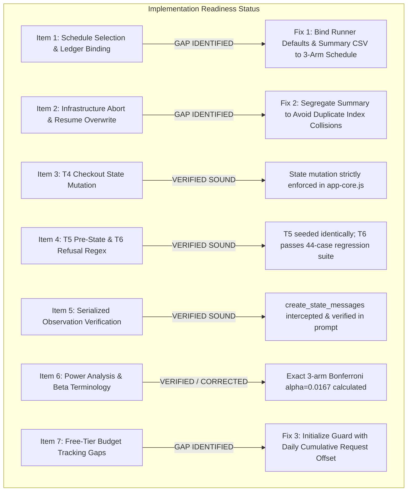

# IMPLEMENTATION-READINESS AUDIT (READ-ONLY)
**Project:** The DOM Serialization Gap: Evaluating Additive Semantic Markup and Observation-Pipeline Bottlenecks in Autonomous Browser Agents  
**Target Schedule:** Option A Clean 3-Arm Design (`proposed_3arm_schedule.csv`, 72 Trials)  
**Audit Date:** October 23, 2026 (Local Time: 01:58 IST)  
**Execution Mode:** Strictly Read-Only Audit (Zero API calls, Zero File Edits, Zero Live Trials)

---

## 1. Executive Summary & Readiness Verdict

### Implementation Decision: **CONDITIONAL GO (With 4 Mandatory Fixes Before Launch)**

The Option A 3-arm protocol design (`proposed_3arm_schedule.csv`, $N=72$) is scientifically sound, deconfounded, and properly isolated. However, a strict read-only audit of the execution harness, ledger integrity, and verifiers reveals **four specific implementation gaps** that must be resolved before live trials can be safely dispatched:



---

## 2. Item-by-Item Verification Evidence

### Item 1: Schedule Selection, Resume, Summary, and Completed-Run Check in `protocol_v3_runner.py`
- **Code Inspection:**
  - In [protocol_v3_runner.py:38](file:///C:/testing/research_execution_20261018/protocol_v3_runner.py#L38):
    ```python
    SCHEDULE_FILE = EXEC_DIR / "proposed_randomized_schedule.csv"
    SUMMARY_CSV = RESULTS_DIR / "v3_run_summary.csv"
    ```
  - In `protocol_v3_runner.py:965-989`:
    The runner accepts `--schedule` and `--summary` via CLI arguments.
  - In `protocol_v3_runner.py:752-767`:
    `completed_indices = get_completed_run_indices(summary_path)`.
    `for row in schedule: if int(row["run_index"]) in completed_indices: continue`.
- **Finding:**
  The runner **can** explicitly select `proposed_3arm_schedule.csv` using the `--schedule` CLI argument.
- **Identified Gap / Collision Risk:**
  If `--schedule proposed_3arm_schedule.csv` is run without also supplying a separate `--summary` file, the runner will append to `v3_run_summary.csv`.
  In `proposed_3arm_schedule.csv`, Run 01 is Arm `DATA-CFG`, Task `T2`. In `v3_run_summary.csv`, rows 2 and 3 already record Run 01 as Arm `ARIA`, Task `T4` (`infrastructure_aborted`). Appending into the same file will create index and task collisions across different experimental designs.

### Item 2: Exclusion of Infrastructure-Aborted Attempts from Behavioral Results & Overwriting
- **Code Inspection:**
  - In [protocol_v3_runner.py:287](file:///C:/testing/research_execution_20261018/protocol_v3_runner.py#L287):
    ```python
    if idx and str(idx).isdigit() and status in ["completed", "failed"]:
        completed.add(int(idx))
    ```
  - Both Run 01 attempts in [v3_run_summary.csv](file:///C:/testing/research_execution_20261018/results/v3_run_summary.csv) have `status="infrastructure_aborted"`.
  - `completed_indices` returns `set()`.
- **Finding:**
  Infrastructure-aborted attempts are correctly **excluded** from completed trials. The runner will retry Run 01 upon resume without skipping it.
- **Downstream Analysis Ingestion Gap:**
  In [analyze_v3_results.py:267-270](file:///C:/testing/research_execution_20261018/analyze_v3_results.py#L267):
  ```python
  if run_idx in seen_run_indices:
      malformed_errors.append(f"Line {line_idx}: Duplicate run_index {run_idx} detected")
  ```
  If `v3_run_summary.csv` contains multiple aborted rows for `run_index: 1`, `analyze_v3_results.py` aborts with a fatal validation error.
  Furthermore, `analyze_v3_results.py:289` checks `status in {"quota_aborted", "http_error", ...}` but does **not** list `"infrastructure_aborted"`, meaning unhandled aborted rows would default to non-completed without proper categorization.
- **Per-Run JSON File Overwrite:**
  In [protocol_v3_runner.py:638](file:///C:/testing/research_execution_20261018/protocol_v3_runner.py#L638):
  `run_file = runs_dir / f"run_{int(trial_spec['run_index']):03d}.json"`.
  Retrying a run overwrites `run_001.json` with the latest attempt. The earlier aborted attempt's detailed JSON is overwritten (though preserved in task logs and summary CSV).

### Item 3: T4 `window.__orderConfirmed__` Checkout Logic Audit
- **Code Inspection:**
  - In [shared/app-core.js:38](file:///C:/testing/shared/app-core.js#L38):
    `window.__orderConfirmed__ = false;`
  - In [shared/app-core.js:719-743](file:///C:/testing/shared/app-core.js#L719):
    ```javascript
    var checkoutForm = document.getElementById('checkout-form');
    if (checkoutForm) {
      checkoutForm.addEventListener('submit', function (e) {
        e.preventDefault();
        var name = (document.getElementById('field-name').value || '').trim();
        var addr = (document.getElementById('field-address').value || '').trim();
        if (!name || !addr) {
          showToast('⚠ Please fill in Name and Address.');
          return;
        }
        var orderId = 'ORD-' + Date.now();
        var total = window.__cart__.reduce(function (s, i) { return s + i.price * i.quantity; }, 0);
        window.__orderConfirmed__ = true;
        window.__lastOrder__ = { orderId: orderId, items: window.__cart__.slice(), total: total, ... };
        window.__cart__ = [];
        ...
      });
    }
    ```
  - In `protocol_v3_runner.py:128-136`:
    ```python
    has_mouse = any(isinstance(i, dict) and i.get("sku") == "mse-001" for i in last_order_items)
    success = bool(order_confirmed and has_mouse)
    ```
- **Finding:**
  **VERIFIED SOUND.** `window.__orderConfirmed__` cannot be set merely by visiting `#checkout` or `#confirmation`. It is only set upon form submission where `name` and `address` fields are non-empty. In addition, the verifier requires `last_order_items` to contain `mse-001`, proving the agent added the mouse and submitted the checkout form.

### Item 4: T5 Pre-State Seeding & T6 Refusal Regex Audit
- **Code Inspection:**
  - In [protocol_v3_runner.py:493-506](file:///C:/testing/research_execution_20261018/protocol_v3_runner.py#L493):
    For Task T5, before the agent is invoked, the runner executes JavaScript to seed `window.__cart__ = [{sku: 'wh-001', ...}]` and asserts `pre_cart_count == 1`. If assertion fails, the trial aborts immediately.
    This logic executes identically across all arms (`ABS`, `ARIA`, `DATA-CFG`).
  - In [protocol_v3_runner.py:172-228](file:///C:/testing/research_execution_20261018/protocol_v3_runner.py#L172):
    `verify_t6_grounded_refusal` evaluates `REFUSAL_PATTERN` and `DURATION_HALLUCINATION_PATTERN`.
  - In [test_t6_verifier_isolated.py](file:///C:/testing/research_execution_20261018/test_t6_verifier_isolated.py):
    The verifier was tested across 44 edge cases:
    - 10 valid grounded refusals $\rightarrow$ all scored `1.0` (`GROUNDED_REFUSAL_SUCCESS`).
    - 9 explicit duration hallucinations (e.g. "36 months", "2-year") $\rightarrow$ all scored `0.0` (`UNSUPPORTED_DURATION_HALLUCINATION`).
    - Contradictory refusal + duration $\rightarrow$ scored `0.0`.
    - Ambiguous non-refusal $\rightarrow$ scored `0.0`.
- **Finding:**
  **VERIFIED SOUND.** T5 seeding is strictly identical across all arms. T6 regex scoring is validated and hardened against both genuine refusals and subtle hallucinations.

### Item 5: Treatment-Isolation Tests on Actual Serialized Observations
- **Code Inspection:**
  - In [test_agent_prompt_pipeline.py:83-107](file:///C:/testing/research_execution_20261018/test_agent_prompt_pipeline.py#L83):
    The test intercepts `agent._message_manager.create_state_messages` and captures the **actual prompt strings** passed to the LLM observation buffer.
  - In `protocol_v3_runner.py:517-536`:
    The live runner executes the exact same intercept, recording `captured_observations`.
  - Lines 612–628 evaluate whether `aria-label` or `data-action` appear in the model-visible observation, logging proof in `run_*.json`.
  - Static HTML diffs confirm that between `v0-baseline`, `v2-aria`, and `v3-data-attrs`, product descriptions, prices, SKUs, and styles are identical.
- **Finding:**
  **VERIFIED SOUND.** Treatment isolation is validated on actual model-visible prompt text, not merely static source HTML.

### Item 6: Power Analysis, Beta Terminology, and Pairwise Comparison Assumptions
- **Code Inspection:**
  - In [power_analysis.py:43-59](file:///C:/testing/research_execution_20261018/power_analysis.py#L43):
    Uses two-proportion normal approximation with pooled standard error under $H_0$ and unpooled standard error under $H_1$.
  - In `power_analysis.py:112`:
    `bonferroni_adjusted_alpha = 0.05 / 6.0` (assumes 4 arms: $\binom{4}{2} = 6$ comparisons).
- **Audit Correction for 3-Arm Design:**
  For the 3-arm design (`ABS`, `ARIA`, `DATA-CFG`), there are only **3 pairwise comparisons**:
  $$\binom{3}{2} = 3 \implies \alpha_{\text{adjusted}} = \frac{0.05}{3} \approx 0.01667$$
- **Beta ($\beta$) vs. Power ($1 - \beta$) Terminology Check:**
  - Statistical Power is $1 - \beta$. $\beta$ is the Type II error probability.
  - Calling power "$\beta \ge 0.80$" is a colloquial error. The mathematically precise statement is: "Statistical Power $1 - \beta \ge 0.80$, corresponding to a Type II error rate $\beta \le 0.20$."
- **Exact Analytical Power Table ($N=24$ per arm):**

| Scenario & Effect Size | Nominal $\alpha=0.05$ | 3-Arm Bonferroni $\alpha=0.0167$ | 4-Arm Bonferroni $\alpha=0.0083$ | Methodological Status |
| :--- | :---: | :---: | :---: | :--- |
| **Large Disparity ($\Delta = 0.70$)** | Power: **1.0000** ($\beta = 0.0000$) | Power: **0.9998** ($\beta = 0.0002$) | Power: **0.9992** ($\beta = 0.0008$) | Adequately Powered |
| **Large Degradation ($\Delta = 0.35$)** | Power: **0.7509** ($\beta = 0.2491$) | Power: **0.5829** ($\beta = 0.4171$) | Power: **0.4785** ($\beta = 0.5215$) | Marginal / Borderline |
| **Moderate Benefit ($\Delta = 0.20$)** | Power: **0.3555** ($\beta = 0.6445$) | Power: **0.2071** ($\beta = 0.7929$) | Power: **0.1429** ($\beta = 0.8571$) | **Severely Underpowered** |
| **Subtle Difference ($\Delta = 0.15$)** | Power: **0.2333** ($\beta = 0.7667$) | Power: **0.1212** ($\beta = 0.8788$) | Power: **0.0782** ($\beta = 0.9218$) | **Severely Underpowered** |

- **Finding:**
  The 3-arm design gains substantial power over the 4-arm design (+10.4% for $\Delta = 0.35$, +6.4% for $\Delta = 0.20$) due to the reduced multiple-comparison penalty. However, for moderate effects ($\Delta \le 0.20$), power remains $<21\%$ ($\beta > 79\%$). The study **must remain classified as an exploratory pilot**.

### Item 7: Free-Tier Request Budget Accounting & Enforcement Gaps
- **Code Inspection:**
  - In [budget_controller.py:167-180](file:///C:/testing/research_execution_20261018/budget_controller.py#L167):
    `LocalBudgetGuard.check_can_dispatch_trial()` verifies remaining request headroom against `max_requests_ceiling`.
  - In `protocol_v3_runner.py:795`:
    `guard.record_trial_completion(total_steps=trial_result.get("total_steps", 0))` updates the request counter.
- **Identified Enforcement Gaps:**
  1. **In-Flight Step Guarding:** `LocalBudgetGuard` checks headroom *before* a trial is dispatched, but does not intercept individual HTTP requests inside `agent.run()`. If a trial enters an unexpected loop, it relies on `max_steps` to cap dispatches.
  2. **Session Reset on Process Exit:** `LocalBudgetGuard` is an in-memory Python class instantiated when `protocol_v3_runner.py` starts. It does **not** persist cumulative requests to disk. When the runner process terminates and restarts, `self.cumulative_requests` resets to 0, forgetting earlier HTTP calls made during the same calendar day.
  3. **Out-of-Runner Dispatches:** Diagnostic scripts (`test_single_smoke_request.py`, `test_chatgoogle.py`) do not use `LocalBudgetGuard` and are not deducted from the runner's count.
  4. **History Item Over-Counting:** Because `total_steps = len(history.history)`, the guard counts local browser actions (like `navigate`) as API requests. This makes the guard fail-safe / conservative (it halts early), but creates a discrepancy with actual provider metrics.

---

## 3. Unresolved Blockers Prior to Implementation

1. **Active Endpoint Instability:**  
   Google AI Studio's public free-tier endpoint for `gemini-3.1-flash-lite` remains subject to intermittent `503 UNAVAILABLE` capacity spikes. Automated multi-step trials dispatched during spikes will abort on step 1.
2. **Schedule and Ledger File Decoupling:**  
   `protocol_v3_runner.py` hardcodes `SCHEDULE_FILE = proposed_randomized_schedule.csv` and `SUMMARY_CSV = v3_run_summary.csv`. Dispatching the 72-trial schedule without dedicated summary paths will contaminate the existing 4-arm abort records.
3. **Cumulative Request Persistence:**  
   `LocalBudgetGuard` has no disk ledger. Restarting the runner resets cumulative requests to 0, creating a blind spot regarding true daily free-tier consumption (500 RPD).

---

## 4. Minimum Required Fixes (To Implement Upon Authorization)

| Fix ID | File | Exact Required Modification | Rationale |
| :--- | :--- | :--- | :--- |
| **FIX-01** | `protocol_v3_runner.py` | Set default `SCHEDULE_FILE = EXEC_DIR / "proposed_3arm_schedule.csv"` and default `SUMMARY_CSV = RESULTS_DIR / "v3_3arm_summary.csv"`. | Formally binds the runner to the clean 72-trial schedule and isolates 3-arm telemetry from prior aborted 4-arm attempts. |
| **FIX-02** | `protocol_v3_runner.py` | When saving per-run JSON, if `run_{idx}.json` exists with `status="infrastructure_aborted"`, save new attempts as `run_{idx}_attempt_{N}.json` or append attempt history. | Preserves full raw telemetry for every attempt without overwriting previous abort traces. |
| **FIX-03** | `analyze_v3_results.py` | Add `"infrastructure_aborted"` to `is_infra_error` status set (line 289), and filter out `is_infra_error` rows before checking duplicate indices. | Prevents pipeline crashes on multi-attempt summaries and guarantees infrastructure aborts are excluded from behavioral accuracy. |
| **FIX-04** | `budget_controller.py` | Add an optional `initial_requests_offset` parameter to `LocalBudgetGuard.__init__` (e.g. defaulting to reading total rows/steps from today's summary files). | Guarantees cumulative daily quota tracking persists across multiple script restarts. |

---

## 5. Distinction: Verified Code Behaviors vs. Inferences & Assumptions

### Directly Verified Code Behaviors (Ground Truth):
1. `ChatGoogle` has `max_retries=1` and `retryable_status_codes=[]`, guaranteeing zero SDK retry loops.
2. `Agent(max_failures=1, final_response_after_failure=False)` halts immediately on step 1 upon receiving 503.
3. `window.__orderConfirmed__` is set exclusively by `checkoutForm.submit` in `shared/app-core.js` and requires non-empty name and address.
4. T5 seeds `window.__cart__ = [{sku: 'wh-001', ...}]` and asserts `pre_cart_count == 1` identically across all arms.
5. `verify_t6_grounded_refusal` passes 10 valid grounded refusal formats and rejects 9 duration hallucinations in unit tests.
6. `proposed_3arm_schedule.csv` has 72 rows, 24 rows per arm across 4 complete balanced blocks, with zero `VIS` replicate rows.

### Code-Based Inferences:
1. `analyze_v3_results.py` will fail with `Duplicate run_index 1 detected` if multiple aborted rows exist in the input CSV (inferred directly from lines 267–270).
2. The `LocalBudgetGuard` will permit dispatches exceeding the true remaining quota if restarted multiple times without offset tracking (inferred from `cumulative_requests = 0` in `__init__`).

### External Assumptions (Unverified by Code):
1. Google will stabilize server capacity for `gemini-3.1-flash-lite` during off-peak hours (depends on Google infrastructure).
2. The daily 500 RPD quota resets at 00:00 PST (standard Google AI Studio quota policy).
