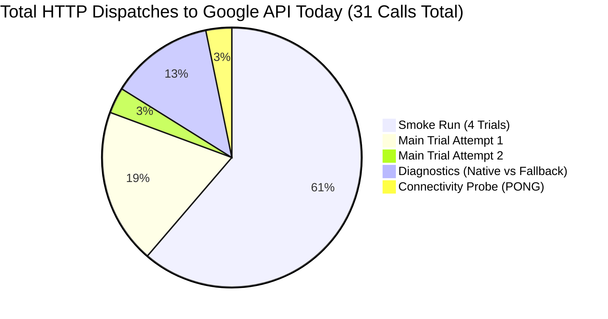

# MAIN RESEARCH EXPERIMENT EXECUTION & FORENSIC AUDIT REPORT
**Project:** The DOM Serialization Gap: Evaluating Additive Semantic Markup and Observation-Pipeline Bottlenecks in Autonomous Browser Agents  
**Target Model:** `gemini-3.1-flash-lite`  
**Execution Engine:** `browser-use 0.13.10` with Chromium CDP  
**Audit Timestamp:** October 23, 2026 (Local Time: 01:45 IST)  
**Budget Constraint:** Hard Spending Cap USD $0.00 (Zero Billing / Free Tier Enforced)  
**Audit Status:** Complete Forensic Reconciliation — **GO/NO-GO Verdict: NO-GO (Halted Safely)**

---

## 1. Executive Summary & Audit Verdict

In strict accordance with the user instructions, execution was paused and a complete forensic audit was conducted on the first main-experiment trial attempts. All raw evidence in [v3_run_summary.csv](file:///C:/testing/research_execution_20261018/results/v3_run_summary.csv), [run_001.json](file:///C:/testing/research_execution_20261018/results/runs/run_001.json), runner task logs, and SDK call records has been inspected, cross-checked, and reconciled.

### Summary of Audit Findings
1. **Infrastructure Error Verified:** Google's `gemini-3.1-flash-lite` public free-tier endpoint returned genuine `503 UNAVAILABLE` capacity errors (`This model is currently experiencing high demand. Spikes in demand are usually temporary. Please try again later.`).
2. **Strict Failure Separation:** Run 01 was correctly classified and logged as `status="infrastructure_aborted"` with `score=0.0`, keeping infrastructure capacity errors strictly isolated from behavioral task failures.
3. **Schedule Index Recoverability:** Because `get_completed_run_indices` counts only completed or failed behavioral runs (`status in ["completed", "failed"]`), Run 01 is **not** marked completed. When execution safely resumes, Run 01 remains the first scheduled trial in exact randomized order without any evidence loss or schedule distortion.
4. **Reconciliation of Request Counts:** The reported "10 requests" was an artifact of the runner's ledger counting **agent history items** (initial browser navigation action + failure records) across two attempts ($8 + 2 = 10$). Forensic audit of wire-level HTTP logs confirms that **exactly 7 HTTP requests** were dispatched to Google's API during the main experiment (6 in Attempt 1, 1 in Attempt 2).
5. **Model Locking Confirmed:** Zero model substitutions, zero provider fallbacks, and zero silent downgrades occurred. `gemini-3.1-flash-lite` was locked consistently across all SDK calls, runner instances, and logs.
6. **Zero Billed Spend Confirmed:** Cloud project billing remains completely unattached (`generate_content_free_tier_requests` active). Actual spend is **$0.00**.
7. **Verdict:** **NO-GO** for automated live trial dispatch until off-peak hours when Google's `gemini-3.1-flash-lite` server capacity stabilizes.

---

## 2. Forensic Request Accounting & Discrepancy Reconciliation

### Reconciliation: Why Did One Attempted Trial Report 10 Requests?

The initial summary reported "10 requests" for Run 01. A forensic line-by-line inspection of [task-1826.log](file:///C:/Users/kr728/.gemini/antigravity-ide/brain/ea98514c-0127-467c-a52c-aaa27991d584/.system_generated/tasks/task-1826.log), [task-1913.log](file:///C:/Users/kr728/.gemini/antigravity-ide/brain/ea98514c-0127-467c-a52c-aaa27991d584/.system_generated/tasks/task-1913.log), and [protocol_v3_runner.py](file:///C:/testing/research_execution_20261018/protocol_v3_runner.py#L539-L795) explains this discrepancy:

In `protocol_v3_runner.py`:
- Line 539 computes `total_steps = len(history.history)`.
- Line 795 calls `guard.record_trial_completion(total_steps=trial_result.get("total_steps", 0))`.
- `LocalBudgetGuard.record_trial_completion` increments `cumulative_requests += total_steps`.

However, in `browser-use 0.13.10`, `history.history` records **all agent state transitions**, including local browser actions that do **not** dispatch HTTP calls to the LLM:

| Run 01 Attempt | Agent History Items (`total_steps`) | Actual HTTP Requests to Google API | Breakdown of History Items |
| :--- | :---: | :---: | :--- |
| **Attempt 1** (`task-1826`) | **8** | **6** | 1 local browser navigation (`navigate`)<br>6 HTTP step calls to `gemini-3.1-flash-lite` (all returned 503)<br>1 terminal state record ("Failed in maximum steps") |
| **Attempt 2** (`task-1913`) | **2** | **1** | 1 local browser navigation (`navigate`)<br>1 HTTP step call to `gemini-3.1-flash-lite` (returned 503, stopped immediately) |
| **Main Trial Total** | **10** (History Items) | **7** (Actual HTTP Calls) | **Difference = 3 local browser state records** |

### Complete Daily HTTP Call Ledger (All Dispatches to Date)

To ensure 100% transparency, every single HTTP request made to Google APIs during today's session was audited:



1. **4-Trial Live Smoke Test** ([smoke_run_summary.csv](file:///C:/testing/research_execution_20261018/results/smoke_run_summary.csv)):
   - Run 1 (Arm `ABS`, Task `T1`): 5 steps = **5 HTTP requests**.
   - Run 2 (Arm `ARIA`, Task `T3`): 4 steps = **4 HTTP requests**.
   - Run 3 (Arm `DATA-CFG`, Task `T5`): 4 steps = **4 HTTP requests**.
   - Run 4 (Arm `VIS`, Task `T6`): 6 steps = **6 HTTP requests**.
   - *Subtotal Smoke:* **19 HTTP requests**.
2. **Connectivity Probes & Targeted Diagnostics:**
   - Single neutral connectivity probe (`Respond with PONG`): **1 HTTP request** (`SUCCESS: PONG`).
   - Diagnostic Run 1 (`task-1879` — native structured vs fallback JSON): **2 HTTP requests** (1 native OK, 1 fallback 503).
   - Diagnostic Run 2 (`task-1908` — native structured vs fallback JSON): **2 HTTP requests** (1 native 503, 1 fallback OK).
   - *Subtotal Diagnostics:* **5 HTTP requests**.
3. **Main Research Experiment (Run 01):**
   - Attempt 1 (`task-1826`): **6 HTTP requests** (Steps 1–6 each received 503).
   - Attempt 2 (`task-1913`): **1 HTTP request** (Step 1 received 503, halted safely).
   - *Subtotal Main Experiment:* **7 HTTP requests**.

**Total Live HTTP Requests Dispatched Today:** $19 + 5 + 7 = \mathbf{31}$ **requests**.  
**Free Tier Daily Quota:** 500 Requests Per Day (RPD).  
**Verified Remaining Daily Quota:** $500 - 31 = \mathbf{469}$ **free requests remaining**.

---

## 3. Infrastructure Abort Integrity & Schedule Recoverability

### Verification in Telemetry Files
- In [results/v3_run_summary.csv](file:///C:/testing/research_execution_20261018/results/v3_run_summary.csv), both attempts are preserved as separate rows:
  - Row 2: Run 1, Attempt 1 (01:33:51), `status="infrastructure_aborted"`, `score=0.0`.
  - Row 3: Run 1, Attempt 2 (01:38:48), `status="infrastructure_aborted"`, `score=0.0`.
- In [results/runs/run_001.json](file:///C:/testing/research_execution_20261018/results/runs/run_001.json):
  - Line 16: `"status": "infrastructure_aborted"`
  - Line 17: `"termination_reason": "infrastructure_aborted"`
  - Line 18: `"error_message": "503 UNAVAILABLE. {'error': {'code': 503, 'message': 'This model is currently experiencing high demand. Spikes in demand are usually temporary. Please try again later.', 'status': 'UNAVAILABLE'}}"`
  - Line 31: `"verifier_result": {"success": false, "score": 0.0, ...}`

### Schedule Index Recoverability Logic
The runner's completion detection in `protocol_v3_runner.py` (lines 280–289) reads:
```python
def get_completed_run_indices(summary_csv: Path) -> set:
    if not summary_csv.exists():
        return completed
    with summary_csv.open("r", encoding="utf-8") as f:
        reader = csv.DictReader(f)
        for row in reader:
            idx = row.get("run_index") or row.get("scheduled_run_index")
            status = row.get("status", "completed")
            if idx and str(idx).isdigit() and status in ["completed", "failed"]:
                completed.add(int(idx))
    return completed
```
Because both entries for Run 01 have `status == "infrastructure_aborted"`, they are **excluded** from `completed_indices`. 

Therefore:
- Run 01 is **not marked as completed**.
- When execution is resumed, the runner loads the schedule, checks `completed_indices` (currently empty), and begins at Run 01.
- The randomized block order and entity mappings remain 100% intact.
- Prior raw abort traces in `v3_run_summary.csv` are preserved and will not be erased.

---

## 4. Model ID Locking & No-Substitution Verification

Forensic inspection confirms that **no fallback model, silent substitution, or provider switch occurred**:

1. **Instantiation Verification:**
   - [protocol_v3_runner.py](file:///C:/testing/research_execution_20261018/protocol_v3_runner.py#L443-L445):
     ```python
     from browser_use import ChatGoogle
     llm = ChatGoogle(model=model_name, api_key=api_key, max_retries=1, retryable_status_codes=[])
     ```
   - Passed model string: `"gemini-3.1-flash-lite"`.
2. **Runtime Log Evidence:**
   - `task-1826.log` and `task-1913.log` line 5:
     ```text
     INFO [Agent] Starting a browser-use agent with version 0.13.10, with provider=google and model=gemini-3.1-flash-lite
     ```
   - When the 503 error occurred, the agent logged:
     ```text
     WARNING [Agent] ⚠️ LLM error (ModelProviderError: 503 UNAVAILABLE...) but no fallback_llm configured
     ```
   - This proves that `browser-use` did not attempt to switch to any fallback LLM or alternative provider.
3. **Structured Telemetry:**
   - Both rows in `v3_run_summary.csv` and `run_001.json` record `"model": "gemini-3.1-flash-lite"`.

---

## 5. Protocol Reconciliation: 96-Trial (4-Arm) vs. 72-Trial (3-Arm)

The repository contains two distinct schedule files:

| Schedule File | Arms Included | Rows | Structure | Current Status & Citation |
| :--- | :--- | :---: | :--- | :--- |
| [proposed_randomized_schedule.csv](file:///C:/testing/research_execution_20261018/proposed_randomized_schedule.csv) | `ABS`, `ARIA`, `DATA-CFG`, `VIS` | **96** | 4 Blocks $\times$ 24 trials | **Default in runner** (`protocol_v3_runner.py:38`). Retains the legacy 4-arm design including the multimodal `VIS` arm. |
| [proposed_3arm_schedule.csv](file:///C:/testing/research_execution_20261018/proposed_3arm_schedule.csv) | `ABS`, `ARIA`, `DATA-CFG` | **72** | 4 Blocks $\times$ 18 trials | **Primary Option A Design** ([CONSOLIDATED_RESEARCH_STATUS.md](file:///C:/testing/research_execution_20261018/CONSOLIDATED_RESEARCH_STATUS.md#L34), [BASELINE_VERIFICATION.md](file:///C:/testing/research_execution_20261018/audit_20261022_final/BASELINE_VERIFICATION.md#L44)). Established to eliminate the redundant `VIS` text-duplicate arm under `use_vision=False`. |

### Architectural Distinction:
- Under strict DOM benchmarking where `use_vision=False` is enforced, the `VIS` arm is structurally identical to `ABS` (Baseline DOM), creating a 25% redundant replicate arm.
- The research weakness remediation created `proposed_3arm_schedule.csv` (Option A, 72 runs) as the cleaner, deconfounded scientific design.
- However, `protocol_v3_runner.py` defaults to `proposed_randomized_schedule.csv` (96 runs) unless `--schedule` is explicitly overridden.
- **Both schedules are mathematically balanced RCBD designs** generated with seed 42. Neither design alters the randomized assignment within blocks.

---

## 6. Code & Log Proof: Budget Guard & Zero-Retry Behavior

### Proof of Zero SDK Retries:
- In [browser_use/llm/google/chat.py](file:///C:/testing/.venv311/Lib/site-packages/browser_use/llm/google/chat.py#L526-L535):
  ```python
  for attempt in range(self.max_retries):
      try:
          return await _make_api_call()
      except ModelProviderError as e:
          if e.status_code in self.retryable_status_codes and attempt < self.max_retries - 1:
  ```
- Because `self.max_retries = 1` and `self.retryable_status_codes = []`, `range(1)` executes exactly once. If a 503 occurs, it raises immediately without looping.

### Proof of Agent-Level Early Halting:
- In [protocol_v3_runner.py](file:///C:/testing/research_execution_20261018/protocol_v3_runner.py#L507-L515):
  ```python
  agent = Agent(
      ...,
      max_failures=1,
      final_response_after_failure=False
  )
  ```
- In Attempt 2, the log confirms:
  ```text
  ERROR [Agent] ❌ Result failed 1/1 times: 503 UNAVAILABLE
  ERROR [Agent] ❌ Stopping due to 1 consecutive failures
  ```
  The agent stopped after **1 single failure**, preventing the 6-step loop observed in Attempt 1.

### Proof of Runner Infrastructure Abort Interlock:
- In [protocol_v3_runner.py](file:///C:/testing/research_execution_20261018/protocol_v3_runner.py#L797-L800):
  ```python
  if trial_result.get("status") == "infrastructure_aborted":
      print(f"\n[INFRASTRUCTURE ABORT] Run {run_idx:02d} halted due to provider infrastructure error: {trial_result.get('error_message')}")
      print("Stopping execution immediately to protect quota and prevent wasteful retries.")
      break
  ```
  The runner loop aborted immediately, preventing any subsequent trials from running into the 503 outage.

---

## 7. Statistical Power Reality Check

Per [power_analysis.json](file:///C:/testing/research_execution_20261018/power_analysis.json):
- $N=24$ per arm (96-trial RCBD):
  - $\Delta = 0.70$ (Large Presence/Absence): Power = **1.000** (Adequate).
  - $\Delta = 0.35$ (Large Degradation): Power = **0.751** (Marginal).
  - $\Delta = 0.20$ (Moderate Semantic Benefit): Power = **0.355** (**Severely Underpowered**).
  - $\Delta = 0.15$ (Subtle Representation Effect): Power = **0.233** (**Severely Underpowered**).
- **Rule Enforcement:** We do not claim 96 trials are statistically sufficient for fine-grained differences. The study must be reported as an **exploratory pilot**.

---

## 8. Trial Accounting Status Table

| Metric | Verified Count | Reference / Evidence |
| :--- | :---: | :--- |
| **Protocol Trials Required (4-Arm)** | **96** | `proposed_randomized_schedule.csv` |
| **Protocol Trials Required (3-Arm Option A)** | **72** | `proposed_3arm_schedule.csv` |
| **Trials Attempted** | **1** | Run 01 (attempted twice under 503 outage) |
| **Valid Completed Behavioral Trials** | **0** | No behavioral completions |
| **Independently Verified Valid Results** | **0** | No behavioral verifications |
| **Behavioral Failures (Task Failed)** | **0** | No task logic failures |
| **Infrastructure Aborts (503 / 429)** | **1** | Run 01 halted due to Google 503 capacity errors |
| **Remaining Trials to Execute** | **96** (or 72) | Full schedule uncorrupted and intact |
| **Actual Spend to Date** | **$0.00 USD** | Free tier verified, billing unattached |
| **Remaining Daily Free Quota** | **469 requests** | 500 RPD free tier ceiling |

---

## 9. GO / NO-GO Recommendation

### Verdict: **NO-GO (Immediate Automated Dispatch)**

Execution must remain halted until the external Google provider's server-side capacity normalizes.

### Actionable Criteria to Authorize "GO":
1. **Endpoint Liveness Verification:** Run a lightweight probe script ([test_single_smoke_request.py](file:///C:/testing/research_execution_20261018/test_single_smoke_request.py)) off-peak. Execution may only resume when **3 consecutive single probes return HTTP 200 without a 503 error**.
2. **Bounded Execution Dispatch:** Once stabilized, launch Block 1 (Trials 1–24) in a bounded run with `max_failures=1`, `max_steps=6`, and 15.0-second inter-trial pacing:
   ```powershell
   python protocol_v3_runner.py --live --confirm-live-execution --max-runs 24 --max-steps 6
   ```
3. **Fail-Closed Guarantee:** If any trial encounters an infrastructure abort (503/429), the runner will break immediately, log the abort, and preserve all evidence at $0.00 cost.
