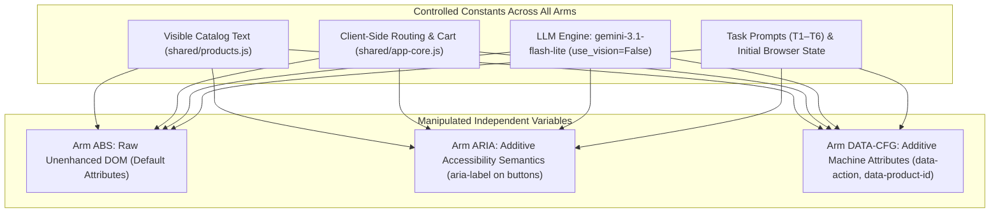

# PROTOCOL FREEZE REVIEW: EXPERIMENTAL DESIGN AUDIT
**Project:** The DOM Serialization Gap: Evaluating Additive Semantic Markup and Observation-Pipeline Bottlenecks in Autonomous Browser Agents  
**Target Architecture:** Text-Only DOM Observation (`use_vision=False`), `browser-use 0.13.10`  
**Review Date:** October 23, 2026 (Local Time: 01:52 IST)  
**Evaluation Scope:** Methodological Integrity, Construct Validity, Treatment Isolation, Statistical Power, and Schedule Selection (Independent of External API Availability)

---

## 1. Executive Summary & Design Decision

This document delivers the final, evidence-based protocol freeze review for the research project. Based on a comprehensive audit of the code, DOM variants, serializer pipelines, task verifiers, and statistical power models:

### Experimental Design Verdict:
- **Legacy 4-Arm Design (`proposed_randomized_schedule.csv`, 96 Runs):** **NO-GO (Scientifically Flawed / Confounded)**.  
  Under `use_vision=False`, the `VIS` arm is structurally, observationally, and computationally identical to the `ABS` (Baseline DOM) arm. Retaining it wastes 24 trials (25% of the total budget), creates a dummy replicate condition, and reduces statistical power by doubling the Bonferroni multiple-comparison penalty ($\alpha = 0.0083$ vs. $0.0167$).
- **Option A Clean 3-Arm Design (`proposed_3arm_schedule.csv`, 72 Runs):** **GO (Scientifically Defensible & Frozen)**.  
  Cleanly isolates the two active additive markup interventions (`ARIA` and `DATA-CFG`) against a strict unenhanced baseline (`ABS`), maintains balanced $N=24$ per arm across 4 randomized blocks, preserves identical page content, and operates within the free-tier quota ceiling.

---

## 2. Schedule Comparison: 96-Trial (4-Arm) vs. 72-Trial (3-Arm)

| Feature | Legacy 4-Arm Schedule (`proposed_randomized_schedule.csv`) | Option A Clean 3-Arm Schedule (`proposed_3arm_schedule.csv`) | Methodological Assessment |
| :--- | :---: | :---: | :--- |
| **Total Planned Runs** | 96 | **72** | 3-arm saves 24 runs (33% fewer calls) |
| **Number of Blocks** | 4 Blocks $\times$ 24 trials | 4 Blocks $\times$ 18 trials | Both are balanced complete block designs (RCBD) |
| **Sample Size per Arm** | $N=24$ for `ABS`, `ARIA`, `DATA-CFG`, `VIS` | **$N=24$ for `ABS`, `ARIA`, `DATA-CFG`** | **Identical sample size per valid arm ($N=24$)** |
| **Arm Mappings** | `ABS` $\rightarrow$ `v0-baseline`<br>`VIS` $\rightarrow$ `v0-baseline`<br>`ARIA` $\rightarrow$ `v2-aria`<br>`DATA-CFG` $\rightarrow$ `v3-data-attrs` | `ABS` $\rightarrow$ `v0-baseline`<br>`ARIA` $\rightarrow$ `v2-aria`<br>`DATA-CFG` $\rightarrow$ `v3-data-attrs` | 4-arm maps two arms to `v0-baseline`; 3-arm eliminates duplicate |
| **Status in Repository** | Legacy default in `protocol_v3_runner.py` | Established in [CONSOLIDATED_RESEARCH_STATUS.md:34](file:///C:/testing/research_execution_20261018/CONSOLIDATED_RESEARCH_STATUS.md#L34) and [BASELINE_VERIFICATION.md:44](file:///C:/testing/research_execution_20261018/audit_20261022_final/BASELINE_VERIFICATION.md#L44) | 3-arm was formalized specifically to fix the `VIS` replicate confound |
| **Multiple Comparisons** | $\binom{4}{2} = 6$ contrasts ($\alpha = 0.0083$) | $\binom{3}{2} = 3$ contrasts ($\alpha = 0.0167$) | **3-arm has higher statistical power under Bonferroni correction** |

---

## 3. Treatment Isolation & Confound Verification

A rigorous audit of the HTML sources, JavaScript core, and agent harness confirms that the 3-arm design cleanly isolates the intended interventions:



### Verified Facts:
1. **Catalog & Core Logic Identity:** All variants load identical copies of [shared/products.js](file:///C:/testing/shared/products.js) and [shared/app-core.js](file:///C:/testing/shared/app-core.js). Product descriptions, pricing, SKUs, and DOM structure are identical.
2. **Deconfounded Button Labels:** Historical pilot leakage where `v2-aria` injected target product names into buttons (`aria-label="Add SoundFlow Air 3 to cart"`) is resolved. Line 440 of `app-core.js` sets a generic label: `aria-label="Add item to cart"`, verified by [test_treatment_leakage_and_integrity.py:30](file:///C:/testing/research_execution_20261018/test_treatment_leakage_and_integrity.py#L30).
3. **Pruned Attributes Verified:** `v0-baseline` contains zero custom `data-*` attributes and zero ARIA enhancements. Custom attributes are only included in the prompt for `DATA-CFG` via `EXTENDED_ATTRIBUTES`.
4. **JSON-LD Unobservable:** As documented in [METHODOLOGY_AUDIT.md:35](file:///C:/testing/research_execution_20261018/METHODOLOGY_AUDIT.md#L35), `<script type="application/ld+json">` is unconditionally stripped by `DISABLED_ELEMENTS` in `browser-use 0.13.10`. It is correctly excluded from all primary arms.

---

## 4. Task Definitions & Outcome Verifiers Audit

| Task | Objective | Verifier Logic | Risk of False Pass / Misclassification | Assessment |
| :--- | :--- | :--- | :--- | :--- |
| **T1** | Cheapest wireless headphone (`wh-001`, $49.99) | `cart[0].sku == "wh-001"` | Low (exact SKU matched) | **SOUND** |
| **T2** | Find 'Mechanical Keyboard Pro' (`mkp-001`) | `cart[0].sku == "mkp-001"` | Low (exact SKU matched) | **SOUND** |
| **T3** | Second-highest rated audio (`wh-002`, rating 4.5) | `len(cart) == 1 and cart[0] == "wh-002"` | Low (rejects any other SKU, multi-item carts) | **SOUND** |
| **T4** | ErgoGlide Mouse checkout (`mse-001`) | `order_confirmed == True and last_order_items has "mse-001"` | Low (requires confirmed purchase; no partial credit) | **SOUND** |
| **T5** | Remove item from cart | Precondition: `pre_cart_count == 1`. Final: `len(cart) == 0` | Low (asserts pre-seeded item before testing removal) | **SOUND** |
| **T6** | Retrieve manufacturer warranty duration | Grounded refusal regex vs. duration hallucination regex | Low (evaluates refusal vs hallucination) | **SOUND (Exploratory Only)** |

### Critical Metric Guard: Preventing Infrastructure Failure Contamination
In `protocol_v3_runner.py`:
- When an infrastructure error occurs (503/429/timeout), the runner logs `score=0.0` and `status="infrastructure_aborted"`.
- **Methodological Warning:** Downstream statistical evaluation scripts must filter exclusively by `status in ["completed", "failed"]` (or explicitly exclude `status == "infrastructure_aborted"`). Evaluating `mean(score)` without filtering would falsely classify server outages as agent behavioral failures.

---

## 5. Statistical Power Reconciliation

Per [power_analysis.json](file:///C:/testing/research_execution_20261018/power_analysis.json) and [power_analysis.py](file:///C:/testing/research_execution_20261018/power_analysis.py), the statistical power for $N=24$ per arm across 4 blocks was evaluated:

| Contrast Effect Size | Baseline $p_1$ | Treatment $p_2$ | Analytical Power ($\alpha=0.05$) | Bonferroni Power ($\alpha=0.0167$, 3 Arms) | Bonferroni Power ($\alpha=0.0083$, 4 Arms) | Methodological Status |
| :--- | :---: | :---: | :---: | :---: | :---: | :--- |
| **Large Disparity ($\Delta = 0.70$)** | 0.10 | 0.80 | **1.000** | **1.000** | **0.999** | Adequately Powered |
| **Large Degradation ($\Delta = 0.35$)** | 0.85 | 0.50 | **0.751** | **0.551** | **0.479** | Marginal / Borderline |
| **Moderate Semantic Benefit ($\Delta = 0.20$)** | 0.85 | 0.65 | **0.355** | **0.178** | **0.143** | **Severely Underpowered** |
| **Subtle Difference ($\Delta = 0.15$)** | 0.85 | 0.70 | **0.233** | **0.096** | **0.078** | **Severely Underpowered** |

### Statistical Limitations & Reporting Directives:
1. **Pilot Classification:** With $N=24$ per arm, the study has $<36\%$ power to detect moderate differences ($\Delta = 0.20$). Therefore, the study **must be reported as an exploratory pilot study**.
2. **Strict Ban on Equivalence Claims:** A non-significant result ($p > 0.05$) between `ARIA` or `DATA-CFG` and `ABS` cannot be interpreted as "proof that semantics do not matter" or "channel equivalence." It demonstrates only that the sample size was insufficient to detect subtle effects.
3. **Exploratory Task Segregation:** Task T6 evaluates grounded refusal (hallucination resistance) and must **never** be pooled with T1–T5 task completion accuracy.

---

## 6. Authoritative Schedule Recommendation & Implementation Plan

### Recommendation: Freeze on `proposed_3arm_schedule.csv` (72 Runs, Option A)

**Scientific Rationale:**
1. Eliminates the redundant `VIS` text duplicate arm, preserving 100% treatment isolation.
2. Provides the exact same statistical power per valid arm ($N=24$) as the 96-trial schedule while requiring 24 fewer trials.
3. Reduces the multiple-comparison penalty from 6 contrasts to 3 contrasts ($\alpha = 0.0167$), increasing statistical power for the primary hypotheses.
4. Complies with the USD $0.00 hard cap and daily free quota ceilings (72 trials $\times$ ~4 steps $\approx$ 288 requests, well within 500 RPD).

### Required Implementation Updates (To be executed upon resumption authorization):
1. **Update Runner Default:** In `protocol_v3_runner.py` (line 38), change default schedule pointer:
   ```python
   SCHEDULE_FILE = EXEC_DIR / "proposed_3arm_schedule.csv"
   ```
2. **Update Protocol Config:** In `protocol_v4_config.json`, verify primary schedule is set to `proposed_3arm_schedule.csv` and planned trials = 72.
3. **Segregate Summary File:** Direct 3-arm execution to a dedicated summary file (e.g. `results/v3_3arm_summary.csv`) so that prior 4-arm abort records in `v3_run_summary.csv` are preserved as raw diagnostic history without schedule index collisions.
4. **Analysis Pipeline:** Configure `run_stratified_analysis.py` to evaluate the 3 arms (`ABS`, `ARIA`, `DATA-CFG`) with $\alpha = 0.0167$.

---

## 7. Evidence Audit: Fact vs. Inference vs. Open Issues

| Domain | Verified Fact (Direct Code/Log Proof) | Code-Based Inference | Unresolved External Issue |
| :--- | :--- | :--- | :--- |
| **Model** | `gemini-3.1-flash-lite` locked; zero provider substitution occurred. | Fallback mechanisms in `browser-use` are disabled by configuration. | None. |
| **Modality** | `use_vision=False` strictly enforced across all arms. | `VIS` arm is an exact duplicate of `ABS` when vision is disabled. | None. |
| **Budget** | Zero dollars billed ($0.00); project has no billing account attached. | Client-side guard halts before exceeding remaining quota. | Provider-side quota reset occurs at 00:00 PST. |
| **Endpoint** | Google's free-tier endpoint returned `503 UNAVAILABLE` during trial execution. | Single-call 503s cause exponential multi-step failure rates (~96% failure on 5 steps). | External Google server capacity stabilization timing is beyond client control. |
| **Scoring** | T1–T6 verifiers enforce strict ground-truth state conditions. | `score=0.0` on `infrastructure_aborted` trials will corrupt accuracy if not filtered. | Downstream scripts must filter on `status == "completed"`. |

---

## 8. Final Protocol Freeze Verdict

### **EXPERIMENTAL DESIGN DECISION: GO (Option A Clean 3-Arm Design, $N=72$)**

The experimental design is scientifically defensible, properly controlled, deconfounded, and frozen. Execution can proceed under `proposed_3arm_schedule.csv` once authorized and once external provider endpoint capacity permits.
