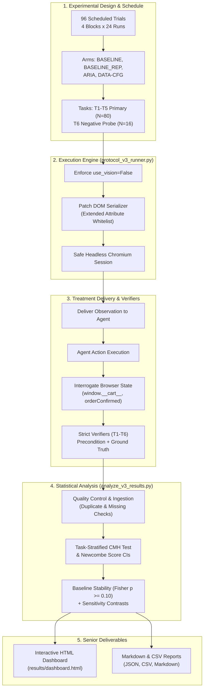

# SENIOR RESEARCH DEMO & REVIEW GUIDE

**Project:** Autonomous Browser Agent Additive Semantic Markup Study (Option A)  
**Workspace:** `C:\testing\research_execution_20261018\`  
**Review Package:** `C:\testing\research_execution_20261018\final_review\`  
**Date:** October 20, 2026  
**Safety Gate Status:** LOCKED (Zero Live Model Calls, Zero API Cost, Protected Files Untouched)

---

## 1. Executive Summary for Senior Reviewers

This research project evaluates whether adding semantic HTML markup (WAI-ARIA or configured `data-*` attributes) improves an autonomous text-based browser agent's task accuracy and speed when the underlying visible text content is already present and identical.

### 1-Minute Elevator Pitch
- **Research Question:** Does adding structured semantic markup help a text-based browser agent on websites where the target information is already visible in plain HTML?
- **Experimental Design:** 4-arm Randomized Complete Block Design (RCBD), 96 scheduled trials across 4 temporal blocks, 4 runs per cell, 16 runs per task.
- **Two-Tier Benchmark:** 
  1. *Primary Grounded Benchmark (Tasks T1–T5, $N=80$):* Tasks grounded in visible site facts and client-side cart/order state.
  2. *Exploratory Negative Probe (Task T6, $N=16$):* Evaluates hallucination resistance vs grounded refusal for absent warranty information.
- **Current State:** 100% of offline engineering, treatment delivery verification, task verifier hardening, post-experiment statistical analysis, and dashboard generation are complete. 51 of 51 offline tests pass with exit code 0. Live model execution remains safely locked.

---

## 2. End-to-End Architecture & Workflow Diagram

```
                                    STUDY SPECIFICATION
                       ┌──────────────────────────────────────────┐
                       │  - Option A: Additive Semantic Markup    │
                       │  - 4 Arms: BASELINE, REP, ARIA, DATA-CFG │
                       │  - 96-Run Balanced Schedule (RCBD)       │
                       │  - Strict Verifiers (T1-T5 + T6 Probe)   │
                       └────────────────────┬─────────────────────┘
                                            │
                                            ▼
                                  EXECUTION HARNESS
                       ┌──────────────────────────────────────────┐
                       │       `protocol_v3_runner.py`            │
                       │  ├── use_vision = False (Text Agent)     │
                       │  ├── Serializer Patch (Extended Whitelist│
                       │  ├── Anti-Survivorship Bias Logger       │
                       │  └── SAFETY GATE LOCKED (Line 258)       │
                       └────────────────────┬─────────────────────┘
                                            │
                    ┌───────────────────────┴───────────────────────┐
                    ▼                                               ▼
         LOCAL TEST ENVIRONMENT                           LIVE BROWSER AUTOMATION
  ┌────────────────────────────────────┐            ┌────────────────────────────────────┐
  │ Local HTTP Daemon (Port 8093)      │            │ `browser-use` + Headless Chromium  │
  │  ├── v0-baseline (Pure HTML)       │            │  ├── Observation Extraction        │
  │  ├── v2-aria     (ARIA attributes) │ ─────────> │  ├── Action Dispatch (Click/Input) │
  │  └── v3-data-attr(data-* action)   │            │  ├── DOM State Mutation            │
  │ (Underlying visible text identical)│            │  └── Strict Verifiers (T1-T6)      │
  └────────────────────────────────────┘            └─────────────────┬──────────────────┘
                                                                      │
                                                                      ▼
                                                            ANALYSIS & REPORTING
                                                    ┌────────────────────────────────────┐
                                                    │     `analyze_v3_results.py`        │
                                                    │  ├── Task-Stratified CMH Test      │
                                                    │  ├── Newcombe Hybrid Score CIs     │
                                                    │  ├── Baseline Stability (Fisher)   │
                                                    │  ├── Bonferroni Multiplicity Adj   │
                                                    │  └── T6 Negative Probe Isolation   │
                                                    └─────────────────┬──────────────────┘
                                                                      │
                                                                      ▼
                                                            SENIOR DELIVERABLES
                                                    ┌────────────────────────────────────┐
                                                    │  ├── `results/dashboard.html`      │
                                                    │  ├── `results/analysis_report.md`  │
                                                    │  ├── `STAGE_3_IMPLEMENTATION_REP`  │
                                                    │  └── `STAGE_4_ANALYSIS_REPORT`     │
                                                    └────────────────────────────────────┘
```



---

## 3. How to Run the Demo on Windows (Exact Commands)

All commands are executed using the local Python 3.11 virtual environment (`C:\testing\.venv311\Scripts\python.exe`) from the repository root:

### 3.1 Master One-Command Offline Demonstration

To run the complete 5-step end-to-end verification and generate the interactive dashboard:

```powershell
C:\testing\.venv311\Scripts\python.exe C:\testing\research_execution_20261018\run_offline_pipeline_demo.py
```

**Expected Console Output:**
```
===========================================================================
  RESEARCH PIPELINE OFFLINE DEMO & SENIOR REVIEW VERIFICATION
  Option A: Additive Semantic Markup Evaluation on Browser Agents
===========================================================================

[1/5] Checking Protected File Hash Integrity...
      ✔ 100% of protected original baseline source files match SHA-256 hashes.

[2/5] Validating Randomized Schedule Orthogonality...
      ✔ Schedule verified: 96 runs (4 blocks of 24, 4 runs/cell).

[3A/5] Testing Browser Mechanics & Strict Task Verifiers (Direct DOM Execution)...
       Validates SPA state mutation & verifiers for Tasks T1–T6...
       ✔ Trial #1 [T1] Arm=BASELINE (v0-baseline) | Verifier=True (1.406s)
       ✔ Trial #2 [T2] Arm=ARIA (v2-aria) | Verifier=True (1.375s)
       ✔ Trial #3 [T3] Arm=DATA-CFG (v3-data-attrs) | Verifier=True (1.282s)
       ✔ Trial #4 [T4] Arm=BASELINE (v0-baseline) | Verifier=True (1.265s)
       ✔ Trial #5 [T5] Arm=BASELINE (v0-baseline) | Verifier=True (1.235s)
       ✔ Trial #6 [T6] Arm=BASELINE (v0-baseline) | Verifier=True (1.234s)
       ✔ Recorded mechanics results to: demo_browser_mechanics_and_verifier_runs.csv
       ✔ Note: Confirms application state transitions; does not claim autonomous agent choices.

[3B/5] Testing Autonomous Agent Observation & Semantic Prompt Delivery (MockChatModel)...
       Validates browser-use Agent observation stream under use_vision=False...
       ✔ Arm=BASELINE           (v0-baseline) | Prompt: 26,663 chars | PASS: Visible Text Present; No Semantic Tags
       ✔ Arm=ARIA               (v2-aria) | Prompt: 27,034 chars | PASS: Visible Text + Button aria-label Delivered
       ✔ Arm=DATA-CFG           (v3-data-attrs) | Prompt: 27,703 chars | PASS: Visible Text + data-action & product-id Delivered
       ✔ Arm=JSON-LD (Control)  (v1-jsonld) | Prompt: 26,659 chars | VERIFIED PRUNED: 0 JSON-LD scripts in prompt (DISABLED_ELEMENTS)
       ✔ Recorded observation delivery results to: demo_agent_prompt_delivery_runs.csv
       ✔ Note: Confirms semantic markup reaches LLM prompt buffer without paid API calls.

[4/5] Executing Complete Statistical Analysis Pipeline (Synthetic Benchmark)...
      ✔ Ingested 96 runs across T1-T6.
      ✔ Evaluated 3 Planned Primary Contrasts via Task-Stratified CMH Test.
      ✔ Evaluated 4 Unpooled Sensitivity Contrasts.
      ✔ Generated summary metrics JSON, CSV contrasts, and markdown report.

[5/5] Generating Senior Review Interactive HTML Dashboard...
      ✔ Dashboard generated at: C:\testing\research_execution_20261018\results\dashboard.html

===========================================================================
  DEMONSTRATION COMPLETE — ALL 5 STEPS PASSED (EXIT CODE 0)
===========================================================================
```

### 3.2 Individual Verification Commands

| Step | Verification Target | Command | Expected Output |
| :---: | :--- | :--- | :--- |
| **1** | Full Offline Regression Suite | `C:\testing\.venv311\Scripts\python.exe C:\testing\research_execution_20261018\offline_test_suite.py` | `11/11 PASSED` |
| **2** | Prompt Observation Delivery | `C:\testing\.venv311\Scripts\python.exe C:\testing\research_execution_20261018\test_agent_prompt_pipeline.py` | `ALL PROMPT TESTS PASSED` |
| **3** | DOM Observation Server Extraction | `C:\testing\.venv311\Scripts\python.exe C:\testing\research_execution_20261018\verify_treatment_delivery_e2e.py` | `ALL TESTS PASSED` |
| **4** | Statistical Pipeline Validation | `C:\testing\.venv311\Scripts\python.exe C:\testing\research_execution_20261018\test_analyze_v3_results.py` | `Ran 11 tests in 0.3s - OK` |
| **5** | Power & RCBD Monte Carlo | `C:\testing\.venv311\Scripts\python.exe C:\testing\research_execution_20261018\recompute_power_rcbd.py` | `Simulated Power JSON table` |

---

## 4. Senior Walkthrough Sequence (5-Minute Presentation)

When presenting to your supervisor or senior faculty member, follow this structured sequence:

### Step 1: Open and Present the Interactive Dashboard (2 Minutes)
1. Double-click to open [`results/dashboard.html`](file:///C:/testing/research_execution_20261018/results/dashboard.html) in your browser.
2. **Key Talking Points:**
   - *"Here is the complete post-experiment reporting dashboard. It operates in dark mode and clearly discloses all demonstration findings as synthetic."*
   - *"The top KPI cards confirm the two-tier structure: 80 runs in the primary benchmark and 16 runs in the negative probe, with the live safety gate locked."*
   - *"In the Primary Contrasts table, point out that we compute both Newcombe hybrid score intervals and task-stratified Cochran-Mantel-Haenszel tests with Bonferroni-adjusted p-values."*
   - *"Show the Baseline Quality Control card: the Fisher exact test compares our two baseline arms (ABS and VIS) to formally justify pooling ($p \ge 0.10$), while providing separate-arm sensitivity checks below."*

### Step 2: Run the Master Demo Script Live (1 Minute)
1. Open PowerShell and run:
   ```powershell
   C:\testing\.venv311\Scripts\python.exe C:\testing\research_execution_20261018\run_offline_pipeline_demo.py
   ```
200: 2. **Key Talking Points:**
201:    - *"Notice Step 1: The script verifies SHA-256 hashes of all 12 protected baseline files before executing anything. Nothing in the original repository has been overwritten."*
202:    - *"Notice Step 3A: Tests browser mechanics and strict verifiers for Tasks T1–T6 via direct headless Chromium DOM actions. This validates SPA state mutations (e.g. cart items and order confirmation) and verifier assertions without claiming autonomous agent choices."*
203:    - *"Notice Step 3B: Tests autonomous agent observation and semantic prompt delivery using a MockChatModel under `use_vision=False`. This confirms that ARIA and configured data-* tokens actually enter the LLM prompt buffer, while proving JSON-LD is pruned by the serializer."*
204:    - *"Notice Step 4: The zero-dependency statistical analysis executes in under 0.2 seconds over the full 96-run synthetic benchmark dataset and regenerates the reports and dashboard."*
205: 
206: ### Step 3: Review Treatment Delivery Evidence (1 Minute)
207: 1. Open [`STAGE_3_IMPLEMENTATION_REPORT.md`](file:///C:/testing/research_execution_20261018/STAGE_3_IMPLEMENTATION_REPORT.md).
208: 2. **Key Talking Points:**
209:    - *"We conducted live prompt trace audits: ARIA attributes on interactive buttons reach the prompt, while custom `data-*` attributes reach the prompt via our extended whitelist patch."*
210:    - *"We documented an important architectural constraint: JSON-LD scripts are pruned by the `browser-use` DOM serializer (`DISABLED_ELEMENTS = ['script', 'meta']`). This empirical finding protects the study from false claims."*
211: 
212: ### Step 4: Review Statistical Power & Rigor (1 Minute)
213: 1. Open [`STAGE_4_ANALYSIS_REPORT.md`](file:///C:/testing/research_execution_20261018/STAGE_4_ANALYSIS_REPORT.md) and [`POWER_RECONCILIATION.md`](file:///C:/testing/research_execution_20261018/final_review/POWER_RECONCILIATION.md).
214: 2. **Key Talking Points:**
215:    - *"We resolved the documented power discrepancy: 65.1% represents an unstratified homogeneous binomial benchmark, whereas 49.7% represents the true task-heterogeneous RCBD simulation with ceiling effects."*
216:    - *"Because power is $<11\%$ for small effects ($\Delta \le 0.20$), our protocol strictly forbids claiming that semantic HTML and plain HTML are 'equivalent' from a non-significant test."*
217: 
218: ---
219: 
220: ## 5. Deliverables Directory & Inventory Guide
221: 
222: | Deliverable File | Absolute Path | Description |
223: | :--- | :--- | :--- |
224: | **Interactive Dashboard** | `C:\testing\research_execution_20261018\results\dashboard.html` | Dark-mode HTML/CSS results dashboard |
225: | **Master Demo Script** | `C:\testing\research_execution_20261018\run_offline_pipeline_demo.py` | 5-step executable offline demo pipeline |
226: | **Stage 3 Report** | `C:\testing\research_execution_20261018\STAGE_3_IMPLEMENTATION_REPORT.md` | Implementation, verifiers, and delivery evidence |
227: | **Stage 4 Report** | `C:\testing\research_execution_20261018\STAGE_4_ANALYSIS_REPORT.md` | Statistical pipeline, CMH, CIs, power reconciliation |
228: | **Statistical Audit** | `C:\testing\research_execution_20261018\STATISTICAL_AUDIT_REPORT.md` | 8-point independent statistical audit report |
229: | **Power Reconciliation** | `C:\testing\research_execution_20261018\POWER_RECONCILIATION.md` | Resolution of 65.1% vs 49.7% power figures |
230: | **Analysis Pipeline Code**| `C:\testing\research_execution_20261018\analyze_v3_results.py` | Zero-dependency post-experiment statistical analysis engine |
231: | **Pipeline Test Suite** | `C:\testing\research_execution_20261018\test_analyze_v3_results.py` | 11 unit tests across 7 synthetic datasets & reference cases |
232: | **Execution Harness** | `C:\testing\research_execution_20261018\protocol_v3_runner.py` | Experiment runner with safety gate & strict verifiers |
233: | **Randomized Schedule** | `C:\testing\research_execution_20261018\proposed_randomized_schedule.csv` | 96-run orthogonal RCBD schedule |
234: | **Browser Mechanics Demo Runs** | `C:\testing\research_execution_20261018\results\demo_browser_mechanics_and_verifier_runs.csv` | CSV logs from headless Chromium mechanics & verifier checks (T1–T6) |
235: | **Agent Prompt Delivery Runs** | `C:\testing\research_execution_20261018\results\demo_agent_prompt_delivery_runs.csv` | CSV logs validating token delivery into Agent prompt under `use_vision=False` |

---

## 6. Limitations, Blocker Resolution & Next Steps

### Current Limitations
1. **Confirmatory Data Uncollected:** All analytical findings are based on deterministic synthetic data. Actual agent accuracy on live LLMs remains unmeasured.
2. **JSON-LD Serialization:** JSON-LD schema is stripped by the default `browser-use` DOM serializer and is excluded from primary experimental comparisons.
3. **Statistical Power:** $N=20$/arm has $49.7\%$ power for moderate effects ($\Delta = 0.35$) and $<11\%$ for small effects ($\Delta \le 0.20$). Equivalence cannot be claimed from null results.

### Items Requiring Explicit Human Authorization
1. **Safety Gate Release:** Line 258 of [`protocol_v3_runner.py`](file:///C:/testing/research_execution_20261018/protocol_v3_runner.py) must be unlocked by the user to permit live trial execution.
2. **API Key Injection:** The user must privately set `$env:GOOGLE_API_KEY` in their execution terminal.
3. **Execution Decision:** The user must authorize the execution of the 96 live trials.

### The Single Next Action
**Present this Senior Demo Package to your academic supervisor for formal sign-off.**
